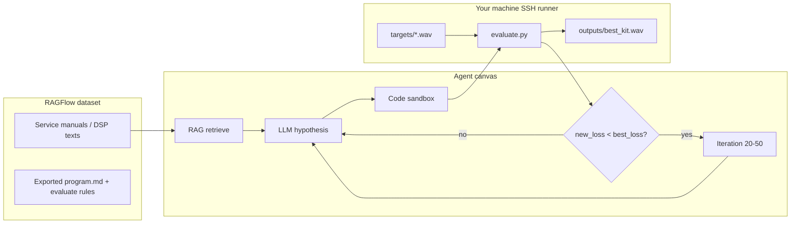

# Autoresearch + RAGFlow (optional orchestrator)

**DiskLordz default:** local **CLI agent** (`factory/autoresearch/program.md` + Git).  
**RAGFlow:** optional visual loop for **10–50 knowledge-grounded** runs, not a replacement for `STACK-FROZEN.md` ship path.

RAGFlow excels at **retrieval over your DSP library** before each hypothesis; Cursor/Claude Code excels at **hundreds of fast `git commit` / revert** cycles on `drum_engine.py`.

---

## Recommended hybrid

| Phase | Tool |
|-------|------|
| Overnight loss chasing | **Cursor / Claude Code** on `disklordz-ralph/factory/autoresearch/` |
| Hardware-informed hypotheses | **RAGFlow** batch (manuals + papers in dataset) → export winning `drum_engine.py` |
| Production merge | Human + Catch2 + `TrapCoreDSP` (`docs/dev/autoresearch-cpp.md`) |

Do **not** add RAGFlow to `STACK-FROZEN.md` unless you opt in via `docs/launch/NEXUS-RUNBOOK.md`.

---

## Architecture



---

## Session variables (conversation / workflow state)

Define these in RAGFlow agent **variables** (names are suggestions; map to your UI labels):

| Variable | Type | Purpose |
|----------|------|---------|
| `best_loss` | float | Running minimum `TOTAL_LOSS` |
| `best_code` | string | Full `drum_engine.py` source at best loss |
| `last_loss` | float | Current iteration |
| `kick_loss` | float | From judge stdout |
| `snare_loss` | float | From judge stdout |
| `hat_loss` | float | From judge stdout |
| `iteration` | int | Loop counter |
| `max_iterations` | int | Default `30` |
| `last_hypothesis` | string | One-line rationale for trace |
| `history` | list | Last N `{iteration, total, kick, snare, hat, hypothesis}` |

**Initialize** at workflow start:

```json
{
  "best_loss": 9999.0,
  "best_code": "<paste baseline drum_engine.py>",
  "iteration": 0,
  "max_iterations": 30,
  "history": []
}
```

---

## Canvas node layout (top → bottom)

1. **Begin** — set `max_iterations`, seed `best_code` from repo baseline.
2. **Loop / Iteration** — bound: `iteration < max_iterations`.
3. **Retrieval** (optional but RAG advantage) — query dataset with:  
   `"transistor soft clip 808 bass drum pitch envelope"` + voice tag (`kick` / `snare` / `hat` if routing per-voice loss).
4. **LLM** — system prompt includes:
   - `program.md` text (multi-voice rules)
   - retrieved chunks (circuit / DSP)
   - `history` last 5 rows
   - **Output JSON only:** `{ "hypothesis": "...", "drum_engine_py": "<full file>" }`
   - Instruct: modify only synthesis; keep `synthesize_kick/snare/hat` signatures.
5. **Code** (sandbox) — **do not let LLM edit this node's template**; only pass variables:

```python
# RAGFlow Code node — judge wrapper (runs on SSH host with repo checkout)
import json
import os
import re
import subprocess
import tempfile
from pathlib import Path

AUTORESEARCH = os.environ.get("DLZ_AUTORESEARCH_ROOT", "/data/disklordz/factory/autoresearch")
code = params["drum_engine_py"]

os.makedirs(AUTORESEARCH, exist_ok=True)
engine_path = Path(AUTORESEARCH) / "drum_engine.py"
engine_path.write_text(code, encoding="utf-8")

proc = subprocess.run(
    ["python", "evaluate.py"],
    cwd=AUTORESEARCH,
    capture_output=True,
    text=True,
    timeout=30,
)
out = proc.stdout + proc.stderr

def grab(name):
    m = re.search(rf"{name}:\s*([0-9.]+)", out)
    return float(m.group(1)) if m else None

result = {
    "ok": proc.returncode == 0 and "ERROR" not in out,
    "total_loss": grab("TOTAL_LOSS") or 9999.0,
    "kick_loss": grab("KICK_LOSS"),
    "snare_loss": grab("SNARE_LOSS"),
    "hat_loss": grab("HAT_LOSS"),
    "render_time": grab("RENDER_TIME"),
    "raw": out[-4000:],
}
```

6. **Condition** — `result.ok && result.total_loss < best_loss`
7. **Branch TRUE** — assign:
   - `best_loss = result.total_loss`
   - `best_code = drum_engine_py`
   - `kick_loss`, `snare_loss`, `hat_loss` from result
   - append to `history`
8. **Branch FALSE** — append failed attempt to `history`; **do not** update `best_code`
9. **Increment** `iteration` → back to Loop
10. **End** — output `best_code`, `best_loss`, path hint `outputs/best_kit.wav` on runner

---

## SSH sandbox provider (local targets + WAV)

RAGFlow’s default ephemeral runners **cannot see** your `targets/` folder. Use one of:

### Option A — SSH runner on your Windows/Linux dev box (preferred)

1. RAGFlow → **Settings → Code execution → SSH provider**
2. Host: machine with repo clone at `DLZ_AUTORESEARCH_ROOT`
3. Ensure `targets/kick.wav`, `snare.wav`, `hat.wav` exist on that host
4. Code node runs `evaluate.py` **in place** — `outputs/best_kit.wav` updates like CLI

Environment on runner:

```bash
export DLZ_AUTORESEARCH_ROOT=/home/you/push/disklordz-ralph/factory/autoresearch
```

### Option B — Spectral targets as JSON (air-gapped sandbox)

1. One-time local script: FFT/envelope features of each target → upload JSON to RAGFlow variable `target_features`
2. Fork a **read-only** `evaluate_features.py` in dataset (not the repo’s immutable `evaluate.py`) — only for RAGFlow
3. **Downside:** no `best_kit.wav` audition without a follow-up local run

DiskLordz repo ships **Option A** as the canonical path; Option B is for cloud-only RAGFlow hosts.

---

## Persisting winners (no `git` inside sandbox)

| Method | How |
|--------|-----|
| **Session export** | End node copies `best_code` to clipboard / download artifact |
| **Webhook** | POST `best_code` to local listener (below) |
| **Manual** | Operator pastes into `drum_engine.py` + `git commit` |

### Optional local webhook (repo helper)

```powershell
cd disklordz-ralph\factory\autoresearch
pip install flask   # one-time on operator machine
python tools\ragflow_persist_win.py --port 8765
```

Configure RAGFlow HTTP node: `POST http://127.0.0.1:8765/persist` body  
`{ "drum_engine_py": "{{best_code}}", "total_loss": {{best_loss}} }`

---

## Knowledge base (what to upload)

| Include | Avoid |
|---------|--------|
| Your notes, Julius O. Smith excerpts you have rights to, **your** schematic derivations | Random TR‑808 ROM dumps, pirated PDFs, commercial sample packs |
| Exported `program.md`, STFT loss explanation | Full copyrighted service manuals unless you own a licensed copy |

Ground prompts: *"synthesis-only, original instruments — circuit docs inform topology, not sample cloning."*

---

## RAGFlow vs CLI (summary)

| | RAGFlow | CLI (Cursor) |
|---|---------|----------------|
| Setup | Canvas + dataset + SSH runner | `program.md` already in repo |
| DSP docs | Hybrid RAG | `@docs` / repo rules / Supermemory |
| Git | Session vars + webhook | Native `commit` / `checkout` |
| Throughput | ~10–50 structured steps | 100+ fast iterations |
| Best for | Manual-grounded hypothesis batches | Overnight autoresearch |

---

## Operator checklist

- [ ] CLI baseline green: `python evaluate.py` with real `targets/*.wav`
- [ ] RAGFlow dataset created; SSH runner points at same checkout
- [ ] Canvas variables match table above
- [ ] First batch `max_iterations=10`; compare `best_loss` to CLI best in `results.tsv`
- [ ] Paste winner → `git commit` → plan C++ port (`autoresearch-cpp.md`)

**Default recommendation:** keep **CLI as primary**; add RAGFlow when you have a **document corpus** worth retrieving (schematics, filter cookbooks) and want **traceable** 30-step experiments—not as a third agent framework on the Lite VST critical path.