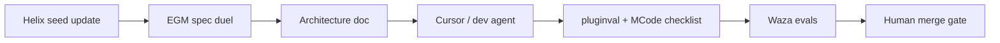

# Elite frameworks — DiskLordz implementation map

Fourteen complementary systems mapped to **in-repo** entry points. All are **opt-in** except static evals that only read the tree. Lite ship path remains `vst/starter-cpp/` per `STACK-FROZEN.md`.

**Index:** `openclaw/elite-frameworks/manifest.yaml`  
**Quick start:** `openclaw/elite-frameworks/README.md`

---

## EGM {#egm}

**Elephant-Goldfish Model** — expand specs (elephant) vs challenge scope (goldfish).

| Artifact | Path |
|----------|------|
| Duel runner | `openclaw/elite-frameworks/egm/run_spec_duel.py` |
| VST template | `openclaw/elite-frameworks/egm/vst-architecture-spec.template.md` |
| OpenClaw skill | `egm_spec_challenge` |

Run before editing `disklordz-ralph/labs/gpu-inference/` or neural editor wiring.

---

## MCode {#mcode}

Coding workflows and checklists for Cursor / Claude.

| Artifact | Path |
|----------|------|
| DSP PR | `openclaw/elite-frameworks/mcode/CHECKLIST-vst-dsp.md` |
| General PR | `openclaw/elite-frameworks/mcode/CHECKLIST-pr.md` |
| Session flow | `openclaw/elite-frameworks/mcode/workflows/cursor-session.md` |

Pairs with team-kit skills: `verify-this`, `review-and-ship`.

---

## Waza {#waza}

Repeatable tests that agents **actually** left required artifacts.

```bash
bash openclaw/elite-frameworks/waza/evals/run_all.sh
```

Skill: `waza_agent_eval`. Add pytest cases when you introduce new contracts.

---

## TokenEconomizer {#token-economizer}

| Artifact | Path |
|----------|------|
| Budget | `openclaw/elite-frameworks/token-economizer/context_budget.yaml` |
| Pruner | `openclaw/elite-frameworks/token-economizer/prune_handoff.py` |

Aligns with Herdr pane handoffs in `disklordz-ralph/vst/templates/drumkit-plugin/AGENTS.md` (40-line log tail for QA).

---

## Agent Desktop {#agent-desktop}

GUI smoke path via `storefront/plugin-faceplate/` and optional `computerUse` tests. See `openclaw/elite-frameworks/agent-desktop/README.md`.

---

## DeepSeek Harness {#deepseek-harness}

Plugin roster for trap-phonk factory — `harness_manifest.yaml` + existing `hermes_roster.yaml` + `run_factory.py` fallback.

Enable in `manifest.yaml` only when operator installs harness packages (`docs/dev/trap-phonk-factory-opt-in.md`).

---

## dsh-superagent {#dsh-superagent}

Prototype workflow: `openclaw/elite-frameworks/dsh-superagent/issue_to_pr_workflow.yaml` chaining sage → dev → review with Waza + EGM gates.

---

## CoworkOS {#coworkos}

Long-running program board: `openclaw/elite-frameworks/coworkos/projects.yaml` (starter-cpp ship, neural lab, trap factory).

---

## OpenBot {#openbot}

Workspace isolation template: `openclaw/elite-frameworks/openbot/workspaces.template.yaml` — mirrors `openclaw/agents/REGISTRY.yaml`.

---

## Helix Foundry {#helix-foundry}

JSON knowledge graph schema + seed linking specs, DSP, storefront, tests, skills. Ingest more nodes when specs change.

Query: load `helix-foundry/seed/vst-helix-seed.json` or extend for RAGFlow export.

---

## Document Parsing Protocol {#document-parsing-protocol}

```bash
python openclaw/elite-frameworks/document-parsing-protocol/ingest.py \
  --in path/to/manual.md --out /tmp/chunks.json
```

Chunk output is AI-friendly JSON for Helix or RAGFlow indexing.

---

## Reverse Engineer Anything {#reverse-engineer-anything}

Legal boundary: `openclaw/elite-frameworks/reverse-engineer-anything/LEGAL.md`  
Research log: `templates/format-research-log.md`

---

## Vercel Security Review {#vercel-security-review}

Storefront checklist: `openclaw/elite-frameworks/vercel-security-review/checklist-storefront.md`  
Use Cursor `security-review` subagent before auth/checkout merges.

---

## OpenDuet {#openduet}

Approval gates: `openclaw/elite-frameworks/openduet/approval_gates.yaml` — storefront live, paid VST, issue→PR merge, factory upload.

---

## Suggested VST architecture flow



---

## Hybrid stack cross-link

Added to `docs/dev/hybrid-agent-stack.md` — this doc is the **meta layer** above OpenClaw skills and MS Agent Framework opt-ins.