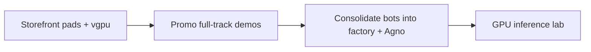

# AI-native growth roadmap (four pillars)

**Status:** Strategy only — not on Lite ship path (`STACK-FROZEN`).  
**Principle:** DiskLordz **synthesis-first** kits stay MIT/Apache where stated; third-party **model licenses** govern any embedded inference or resold stems.

This doc maps MarkTechPost-style ideas to **this repo** and **honest sequencing**.

---

## Pillar 1 — Local GPU inference inside JUCE (TensorRT Model Connect)

**Pitch:** “Generate” in the DAW → GPU-accelerated stems, no cloud subscription.

| Reality check | |
|---------------|--|
| **Fit** | High differentiation *if* weights are license-clean and RT contract is solved |
| **Conflict** | Good Money / ship docs say **no downloaded sample banks**; neural gen is a **new product lane**, not a drop-in for `TrapCoreDSP` |
| **Engineering** | CUDA/TensorRT build matrix, GPU buffer handoff to `processBlock`, offline warmup, pluginval + GPU driver variance |
| **Repo home (future)** | `disklordz-ralph/labs/gpu-inference/` — headless CLI first, JUCE wrapper second |

**Phase 0 (R&D):**

1. Apache-2.0 (or commercial-cleared) **small** audio model only.
2. `trtexec` / Model Connect export → Windows DLL.
3. Offline WAV benchmark (latency, determinism) **before** FL/Ableton claims.
4. Separate product ID + EULA from **Detroit Phonk Lite**.

**Do not** ship TensorRT inside `starter-cpp` until pluginval + REA sign off on non-RT worker thread contract.

---

## Pillar 2 — Full-track demo engine (MiniMax-Music3 + LiquidCodec)

**Pitch:** Full 5-minute trap/phonk demos on the store; LiquidCodec instant mobile preview.

| Reality check | |
|---------------|--|
| **Fit** | Strong **conversion** — kits sell in context of a beat |
| **Legal** | **Read MiniMax open-weights terms** — likely **promo-only** unless cleared for resale |
| **Engineering** | Caption → arrangement batch job; LiquidCodec for **streaming** storefront, not VST RT |

**Phase 0:**

1. **Promo-only** policy in `LICENSING.md` (demos ≠ sold WAV packs).
2. Batch script under `business/demo-tracks/` (stub): caption in → WAV out → manifest.
3. LiquidCodec on `storefront/` or Agno `configurator.html` successor — **opt-in** `docs/dev/` entry when API chosen.

**Reuse:** `audio-factory` mastering (-1 dBFS), `/disk-marketing-kit`, OpenMontage Template A/B.

---

## Pillar 3 — Bot roster (Hermes Bot Mode + DeepSeek Harness)

**Pitch:** Nightly sound designer + packager + growth engine.

| Reality check | |
|---------------|--|
| **Fit** | Overlaps **existing** stack — don’t add a fourth framework without pruning |
| **Already in repo** | `factory_swarm`, `audio-factory`, `openclaw` crons, `agno` scheduler, `deep-agents` long jobs |

**Recommended mapping (no Hermes required on day 1):**

| Bot | DiskLordz equivalent |
|-----|----------------------|
| Sound Designer | `factory_swarm` + `good-money-drum-lab` renderer |
| Packager | `process_and_master_sample_pack` + `package_release.py` |
| Growth | `openclaw` `vst_market_intel` + `/disk-marketing-kit` + OpenMontage |

**Phase 0:** Hermes/DeepSeek Harness as **opt-in** only if it replaces a cron — document in `docs/dev/hybrid-agent-stack.md` after one bot wins an A/B week.

**Human gates:** Shopify/email/video publish unchanged (`HUMAN_GATE`).

---

## Pillar 4 — Interactive storefront (Vercel vgpu + UI SDK)

**Pitch:** WebGPU pad grid + shaders in browser before checkout.

| Reality check | |
|---------------|--|
| **Fit** | Complements static `storefront/`; aligns with **Agno configurator** and WebView2 drum template |
| **Engineering** | vgpu shaders + sample trigger from **your** WAV URLs (CDN); not generative unless Pillar 2 wired |
| **Security** | Strix storefront XSS/redirect audit before public |

**Phase 0:** ✅ scaffold

1. `storefront/interactive-lab/` — Web Audio pads + bass-reactive CSS (vgpu-ready).
2. Add `@vercel/vgpu` shader **after** demo WAV CDN paths are stable.
3. `cursor-cloud-publish-app` or Vercel deploy — private preview first.

**Reuse:** `dist_sample_pack/manifest.json`, `velocity_layers.json`.

---

## Suggested execution order (revenue vs risk)

1. **Pillar 4 lite** — interactive pads on mastered kits (fastest conversion test).
2. **Pillar 2 promo** — licensed full-track demos only.
3. **Pillar 3** — deepen **existing** swarms; add Hermes only if needed.
4. **Pillar 1** — separate **GPU Lab** product after legal + RT architecture.

---

## One-line positioning (when ready)

> **Infinite royalty-free trap & phonk *synthesis*—and optional local GPU stems—in your DAW.**

Until Pillar 1 ships, omit “infinite generated” from Lite/Core copy; use **synthesis-only** language from `LICENSING.md`.

---

## Related docs

- `docs/dev/hybrid-agent-stack.md`
- `docs/dev/agno-revenue-engine-opt-in.md`
- `docs/dev/deep-agents-opt-in.md`
- `docs/plans/good-money-drum-lab-spec.md`
- `docs/security/strix-vst-audit-playbook.md`