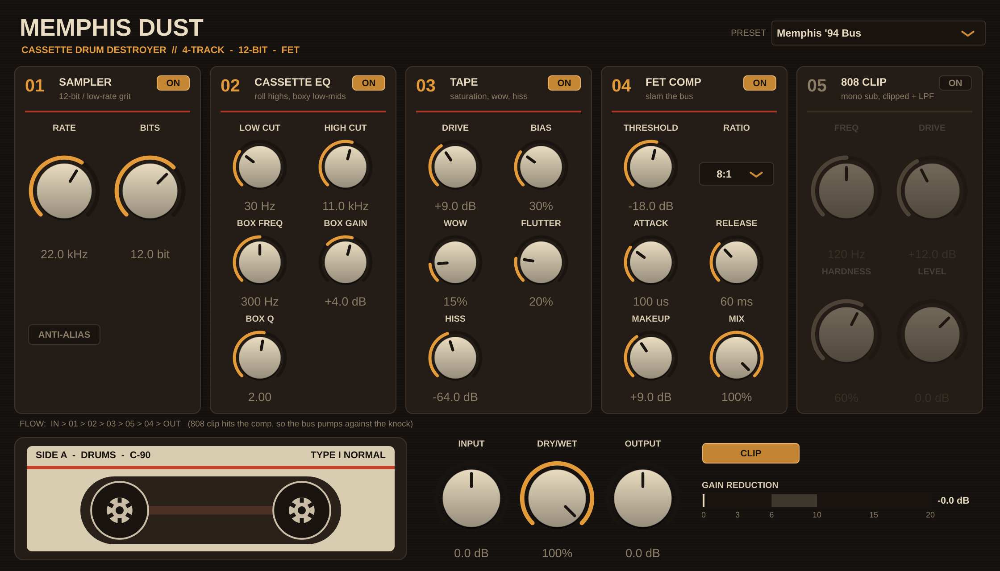

# Memphis Dust

A drum-bus plugin (VST3 / AU / Standalone, JUCE 8) that turns clean, modern drum samples into dusty 90s Memphis cassette-tape drums. It does the five steps of the classic workflow in one plugin:



| # | Section | What it does | Key DSP |
|---|---------|--------------|---------|
| 01 | **Sampler** | 12-bit / low-rate grit (SP-1200, S900, SP-202) | Fractional zero-order-hold decimation (2–48 kHz), mid-tread quantiser with full-scale hard clip (4–16 bit). No reconstruction filter, so you get real aliasing. Optional 4th-order anti-alias pre-filter for the smoother S900 sound. |
| 02 | **Cassette EQ** | Rolls off the highs and adds a boxy low-mid "cardboard" thwack | 12 dB/oct low cut → narrow RBJ bell (150–600 Hz, default +4 dB @ 300 Hz, Q 2) → 24 dB/oct Butterworth high cut (default 11 kHz) |
| 03 | **Tape** | Saturation, wow/flutter, hiss | 2× oversampled biased-tanh saturator with pre-/de-emphasis, so highs saturate first like real tape (the shelves are exact inverses). Wow (0.55 Hz + random drift) and flutter (6.5 + 11.3 Hz + noise) through a Hermite-interpolated delay. Pink hiss, calibrated so the knob reads RMS dBFS. |
| 04 | **FET Comp** | 1176-style bus slam | Stereo-linked peak detector, 20 µs–30 ms attack, program-dependent release (recovers up to 3× slower when slammed), 4/8/12/20:1 + **ALL** (all-buttons: overshoot + extra grit), FET colour that scales with gain reduction, parallel mix. The meter marks the 6–10 dB "Memphis zone". |
| 05 | **808 Clip** | Mono, clipped sub that still shows up on phones and car speakers | LR4 crossover (flat when recombined) → lows summed to mono → tanh/hard-clip blend → 24 dB/oct LPF at the same frequency (default 120 Hz) → added back to the untouched highs |

**Signal flow:** `IN → 01 → 02 → 03 (sat → wow/flutter → hiss) → 05 → 04 → OUT (gain → soft clip) → dry/wet`

The 808 clipper runs *before* the compressor so the bus pumps against the knock. Hiss goes in before the compressor so it breathes with the drums, as in step 4 of the blueprint.

### Globals
Input, Dry/Wet (latency-compensated), Output, and **CLIP**: a soft clipper at 0 dBFS (the "mixer pushed into the red" sound). It also acts as a safety ceiling.

### Factory presets
`Memphis '94 Bus` (default) · `Portastudio Slam` · `SP Crunch (26k/12)` · `8-Bit Basement` · `808 Car Knock` · `Parallel Smash` · `Clean (Init)`
All presets are gain-staged to land within about ±2 dB of the input loudness.

## Build

You need CMake ≥ 3.22 and a C++17 compiler (Xcode on macOS, Visual Studio 2022 on Windows, gcc/clang on Linux).

```bash
cd memphis-dust
cmake -B build -DCMAKE_BUILD_TYPE=Release          # downloads JUCE 8.0.4 automatically
# or: cmake -B build -DJUCE_DIR=/path/to/JUCE      # use a local JUCE checkout
cmake --build build --config Release -j
```

Builds end up in `build/MemphisDust_artefacts/Release/{VST3,AU,Standalone}/`.
To install, copy the `.vst3` into your plugin folder:
- macOS: `~/Library/Audio/Plug-Ins/VST3` (AU: `~/Library/Audio/Plug-Ins/Components`)
- Windows: `C:\Program Files\Common Files\VST3`
- Linux: `~/.vst3`

Or set `COPY_PLUGIN_AFTER_BUILD TRUE` in `CMakeLists.txt` to have the build install it for you.

Linux needs these packages: `libasound2-dev libx11-dev libxrandr-dev libxinerama-dev libxcursor-dev libxcomposite-dev libfreetype-dev libfontconfig1-dev libgl1-mesa-dev`.

### Tests
`tests/DspTests.cpp` checks each DSP stage numerically without JUCE: quantiser levels, EQ response, exact pre-/de-emphasis inverse, the clean W/F delay, hiss calibration, mono sub, and compressor gain reduction.
```bash
cmake --build build --target dsp_tests && ./build/dsp_tests
```

## Tips
- **Put it on the drum bus.** For the full blueprint, put a second instance on the 808 with only 05 (and maybe 03) switched on.
- Rate **26.04 kHz / 12 bit** is the SP-1200. **22.05 kHz / 12 bit** is the default Memphis grit. **11 kHz / 8 bit** is the Basement crunch.
- Push the comp until the meter sits in the shaded 6–10 dB zone, then raise Hiss until you can just hear it breathe between hits.
- Latency is about 1 ms of oversampling filters + 3 ms of tape transport (193 samples at 48 kHz), and it is reported to the host, so PDC keeps everything aligned.
